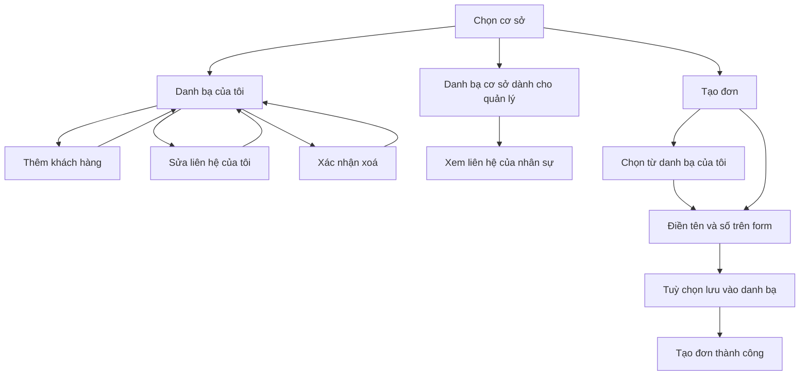

# Luồng màn hình danh bạ khách hàng — BBN-070

Thiết kế nghiệp vụ: [design.md](../../../../initiatives/customer-contacts/design.md). Tài liệu này bàn giao màn hình cho
Figma; chưa phải giao diện đã triển khai.

## Phạm vi hiển thị

Tất cả màn hình dưới đây nằm trong **FLUTTER APP / REACT PWA**, sau đăng nhập
và chọn cơ sở đang làm việc. Không có web công khai hoặc đường dẫn lời mời.
CTV không thuộc task. Mỗi màn hình thể hiện tên cơ sở đang thao tác.

## Các màn hình

| Mã    | Màn hình                 | Người dùng và nội dung                                                                                           | Thao tác, kết quả và lỗi                                                                                                                                                                                                                                     |
| ----- | ------------------------ | ---------------------------------------------------------------------------------------------------------------- | ------------------------------------------------------------------------------------------------------------------------------------------------------------------------------------------------------------------------------------------------------------ |
| DB-01 | Danh bạ của tôi          | Người có quyền danh bạ. Hiện tên khách, số điện thoại, ghi chú; ô tìm kiếm; nút thêm; danh sách có tải thêm.     | Tìm tên có/không dấu hoặc số; thêm → DB-03; sửa liên hệ của mình → DB-04; xoá → DB-05. Không có dữ liệu: “Chưa có khách hàng trong danh bạ”, có nút thêm. Tải lỗi: nút thử lại.                                                                              |
| DB-02 | Danh bạ cơ sở            | Owner/Manager/Vice. Chuyển giữa “Của tôi” và “Danh bạ cơ sở”; có bộ lọc người lưu. Mỗi liên hệ có tên người lưu. | Liên hệ của người khác chỉ xem, không có sửa/xoá/chọn đặt đơn. Liên hệ của mình có thao tác giống DB-01. Không thấy dữ liệu của cơ sở khác.                                                                                                                  |
| DB-03 | Thêm khách hàng          | Tên và số điện thoại bắt buộc; ghi chú tuỳ chọn.                                                                 | Lưu → về danh sách và thấy liên hệ. Số đã có: “Số điện thoại đã có trong danh bạ của bạn”, cho chọn liên hệ của mình hiện có. Số từng xoá: lưu sẽ đưa liên hệ trở lại danh sách với tên/ghi chú vừa nhập. Dữ liệu sai: báo tại trường, giữ nội dung đã nhập. |
| DB-04 | Sửa khách hàng           | Chỉ mở cho liên hệ của mình. Điền sẵn tên, số và ghi chú.                                                        | Lưu → danh sách cập nhật. Số trùng liên hệ khác, kể cả đã xoá: báo trùng và giữ form. Huỷ → không lưu. Thông tin khách trên các đơn đã tạo không đổi.                                                                                                        |
| DB-05 | Xác nhận xoá             | Hiện tên và số liên hệ của mình: “Xoá khách hàng này khỏi danh bạ? Các đơn đã tạo vẫn giữ nguyên thông tin.”     | Xoá → bỏ liên hệ khỏi danh sách; huỷ → quay lại. Lỗi lưu: giữ hộp xác nhận và cho thử lại.                                                                                                                                                                   |
| DB-06 | Chọn khách khi tạo đơn   | Mở từ form tạo đơn; chỉ liệt kê liên hệ của chính người tạo tại cơ sở đó. Có tìm kiếm.                           | Chọn → điền tên/số rồi đóng bộ chọn; huỷ → giữ form. Quản lý cũng không thấy liên hệ người khác ở bộ chọn này.                                                                                                                                               |
| DB-07 | Thông tin khách trên đơn | Tên, số điện thoại; lựa chọn “Lưu vào danh bạ”, mặc định tắt.                                                    | Chọn khách có sẵn → không cần lưu thêm. Sửa tên/số → dùng nội dung mới, không tự sửa danh bạ. Bật lưu → yêu cầu đủ tên/số. Tạo đơn thành công → hoàn tất cả lưu danh bạ nếu đã chọn. Tạo đơn thất bại → chưa lưu khách.                                      |

## Đường đi chính

## Trạng thái cần thể hiện

- Đang tải, đang lưu, không có dữ liệu, không tìm thấy kết quả và lỗi có thể thử lại.
- Trong lúc lưu khoá nút gửi để tránh bấm lặp; lỗi giữ lại nội dung form.
- Bị thu hồi quyền hoặc tạm dừng làm việc: “Bạn không có quyền truy cập.”,
  kết thúc thao tác và cho quay về màn hình cơ sở/tài khoản.
- Nhân sự đã nghỉ vẫn có thể xuất hiện với tư cách người lưu trong danh bạ cơ sở;
  cấp quản lý chỉ xem liên hệ đó.
- Mở hai thiết bị rồi sửa danh bạ: form đơn đang mở giữ tên/số đã điền;
  không có hộp xác nhận phụ chỉ vì danh bạ thay đổi.
- Khi tạo đơn và chọn lưu số đã tồn tại, không tạo liên hệ trùng hoặc ghi đè
  tên/ghi chú hiện có. Đơn vẫn dùng tên/số trên form.
- Sau khi tạo đơn, quay lại danh bạ sẽ tải dữ liệu mới; không cần chờ thông báo.
- Không có màn hình lịch sử đơn khách, xếp hạng, chuyển chủ liên hệ hoặc CTV.
