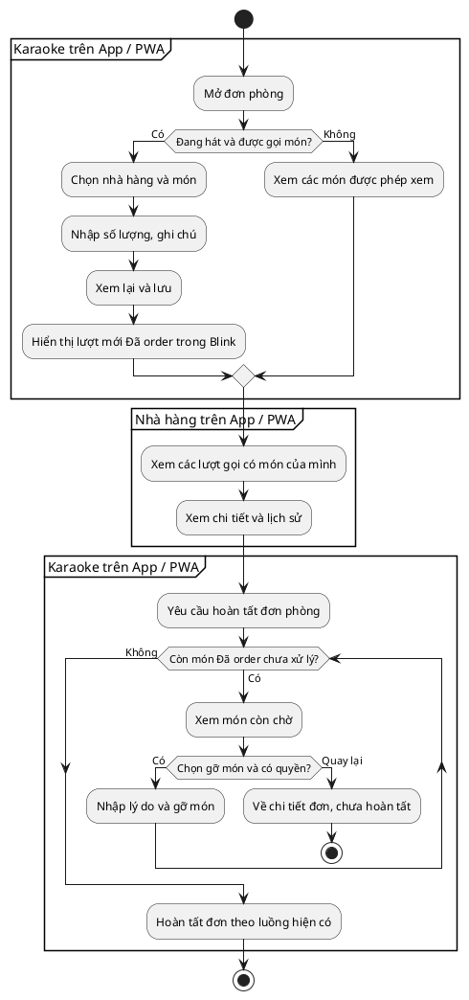

# Luồng màn hình gọi món và nhà hàng xem đơn — BBN-030

**Căn cứ:** design.md đã được duyệt ngày 29/10/2026.
**Nơi sử dụng:** App Flutter / React PWA đã đăng nhập. Không có trang public,
link mời hoặc bước chuyển từ trình duyệt public sang app trong luồng này.
**Phạm vi tài liệu:** bàn giao Designer; chưa triển khai giao diện trong task BE.

> Chỉ xây Blink. Chưa đồng bộ Max360. Lưu món thành công chỉ nghĩa là đã lưu
> trong Blink, không hiển thị “Nhà hàng đã nhận” hoặc “Đã đồng bộ Max360”.
> Nhà hàng trên Blink chỉ xem, không có nút xử lý đơn.

## 1. Người dùng và điểm vào

| Người dùng                          | Điểm vào                                         | Phạm vi                                 |
| ----------------------------------- | ------------------------------------------------ | --------------------------------------- |
| Chủ, quản lý chi nhánh, phó quản lý | Cơ sở đang chọn → đơn phòng → Món đã gọi         | Đơn thuộc cơ sở mình có quyền           |
| Phục vụ                             | Đơn mình tạo hoặc nhận phòng → Món đã gọi        | Chỉ đơn thuộc phạm vi được phép         |
| Booking được cấp quyền gọi món      | Đơn mình tạo → Món đã gọi                        | Chỉ đơn của mình                        |
| Nhà hàng                            | Cơ sở nhà hàng → Đơn hàng                        | Chỉ món thuộc nhà hàng mình             |
| Blink Admin                         | Web quản trị → quyết định chấm dứt cơ sở / Audit | Giữ giao diện và quyền quản trị hiện có |

Mỗi nút chỉ xuất hiện khi người dùng có đúng quyền. Chọn được cơ sở không có
nghĩa được thao tác mọi đơn. Thu ngân/đăng nhập/gắn ca không được thiết kế lại.

## 2. Chi tiết đơn phòng — Món đã gọi

**Nơi hiển thị:** Flutter / React PWA, phía Karaoke.

Đầu trang: cơ sở, mã đơn, tên phòng hiện tại và tình trạng Đang hát/Đã kết thúc.
Danh sách chia theo lượt gọi và nhà hàng; mỗi dòng có tên món, số lượng,
đơn giá lúc gọi, ghi chú, thời điểm gọi và trạng thái.

- Đã order: có Sửa, Gỡ nếu được phép.
- Đã xuất kho: chỉ xem; không Sửa/Gỡ/Chọn lại trạng thái.
- Từ chối: hiển thị lý do và nút Chọn món thay thế khi đơn vẫn được gọi mới.
- Món đã gỡ: chuyển vào phần Lịch sử món đã gỡ, giữ lý do/người/thời điểm;
  không nằm trong danh sách còn phục vụ và không chặn hoàn tất đơn.

Nút Gọi thêm món mở màn chọn nhà hàng. Gọi lại cùng món tạo dòng mới; không
cộng số lượng vào lượt cũ. Chọn Lịch sử để xem thay đổi số lượng/ghi chú/gỡ.
Trống: “Chưa có món nào”, hiện Gọi món nếu đơn đang hát và đủ điều kiện.

## 3. Chọn nhà hàng và chọn món

**Nơi hiển thị:** Flutter / React PWA, phía Karaoke.

Từ đơn đang hát → Gọi món → chọn một nhà hàng đang hợp tác → danh sách món.
Có ô tìm tên và tải thêm/chuyển trang. Món hiển thị ảnh hoặc hình thay thế,
tên, giá VND và mô tả. Chỉ món đang bán được chọn.

Nhập số lượng, ghi chú từng món, rồi chọn Xem lại. Không có tồn kho, menu,
combo hoặc trường tự nhập đơn giá. Một lượt chỉ gửi đến một nhà hàng; muốn
nhà hàng khác thì thực hiện lượt gọi tiếp theo.

Không có nhà hàng phù hợp: “Chưa có nhà hàng đang hợp tác để gọi món”.
Không có món: “Nhà hàng chưa có món đang bán”. Quay lại đơn mà không lưu.

## 4. Xem lại và xác nhận gọi món

**Nơi hiển thị:** Flutter / React PWA, phía Karaoke.

Hiển thị cơ sở/phòng, nhà hàng nhận và từng món, số lượng, đơn giá, ghi chú.
Nút Lưu món / Quay lại chỉnh sửa. Không hiển thị tổng hóa đơn hoặc thanh toán.
Khóa nút khi đang gửi để tránh bấm nhiều lần.

Thành công: “Đã thêm món vào đơn trên Blink” → trở lại danh sách, lượt mới
ở Đã order. Không dùng nội dung khẳng định Max360 hoặc nhà hàng đã nhận.
Món vừa ngừng bán/cơ sở bị chặn: giữ lựa chọn, nêu món không còn hợp lệ để
người dùng bỏ/chọn lại; không âm thầm thay món khác.

## 5. Sửa dòng Đã order

**Nơi hiển thị:** Flutter / React PWA, phía Karaoke.

Mở dòng → Sửa. Tên món, nhà hàng và đơn giá cũ chỉ xem; cho sửa số lượng và
ghi chú. Nút Lưu / Hủy. Hủy không thay đổi dữ liệu đã lưu.

Nếu cơ sở bị hạn chế/tạm dừng hoặc hai bên ngừng hợp tác: chỉ cho giảm số
lượng/sửa ghi chú món cũ. Không tăng số lượng, gọi mới hoặc chọn món thay thế.
Muốn giảm về không còn món thì chuyển sang thao tác Gỡ có lý do.

Người khác vừa thay đổi: “Món đã được thay đổi. Vui lòng tải lại trước khi
lưu.” Không tự ghi đè, không hiện từ kỹ thuật như version hay conflict.

## 6. Gỡ món

**Nơi hiển thị:** Flutter / React PWA, phía Karaoke.

Mở dòng Đã order → Gỡ → hộp xác nhận có tên món, số lượng và ô Lý do bắt buộc.
Ví dụ nội dung: khách về sớm/gọi nhầm. Nút Gỡ món / Quay lại.

Thành công: món rời danh sách đang phục vụ, xuất hiện ở lịch sử có lý do,
người gỡ và thời điểm. Không gán nhãn nhà hàng Từ chối cho món này.
Không cho gỡ món đã xuất kho; lỗi giữ nguyên danh sách và cho tải lại.

## 7. Thay món bị từ chối

**Nơi hiển thị:** Flutter / React PWA, phía Karaoke.

Dòng Từ chối → xem lý do → Chọn món thay thế → chọn nhà hàng/món hợp lệ →
xem lại → lưu lượt mới. Lượt mới thể hiện “Thay cho …”; món cũ vẫn trong
lịch sử, không mất lý do. Có thể Quay lại/bỏ qua mà không phát sinh món mới.

Trong giai đoạn chưa đồng bộ, không có thao tác Restaurant tạo từ chối từ
Blink. Designer vẫn mô tả màn này để hiển thị dữ liệu khi có trạng thái hợp
lệ; Backend kiểm thử bằng dữ liệu mẫu, không cung cấp nút giả để tạo trạng thái.

## 8. Hoàn tất đơn phòng

**Nơi hiển thị:** Flutter / React PWA, phía Karaoke.

Chọn Hoàn tất đơn. Nếu còn món Đã order chưa gỡ, hiển thị “Còn món chưa xử
lý” kèm tên món, số lượng và nhà hàng; nút Xem món còn chờ / Quay lại.
Không tự gỡ, tự từ chối hoặc đánh dấu xuất kho khi nhấn hoàn tất.

Trong phạm vi hiện tại có thể gỡ hợp lệ món chờ rồi thử lại. Không bổ sung
nút xuất kho/từ chối cho nhà hàng trên Blink để vượt bước này. Khi không còn
món chờ, tiếp tục luồng hoàn tất đơn hiện có; không thiết kế thanh toán.

Nếu đơn vừa kết thúc bởi người khác, quay về chi tiết chỉ xem. Không lưu
món mới sang lần sử dụng tiếp theo của cùng phòng.

## 9. Nhà hàng — danh sách và chi tiết đơn

**Nơi hiển thị:** Flutter / React PWA, tài khoản Restaurant.

Danh sách: Karaoke/chi nhánh nguồn, mã đơn/lượt gọi, phòng, thời điểm, số món
và các trạng thái có trong lượt. Bộ lọc Karaoke, ngày, trạng thái; phân trang.
Không tạo thêm một trạng thái chung mới cho đơn có món kết quả khác nhau.

Chọn lượt → chi tiết: chỉ món thuộc nhà hàng mình, số lượng, đơn giá lúc gọi,
ghi chú, trạng thái, lý do từ chối/gỡ và lịch sử. Có thể xem phòng nguồn và
phòng hiện tại khi khách đổi phòng. Không hiển thị món đối tác khác, tên/số
điện thoại khách hoặc hồ sơ danh tính nhân sự.

Chỉ có thao tác điều hướng/xem/lọc/tải lại. Không có nút Nhận đơn, Xuất kho,
Từ chối, Sửa, Xóa hoặc liên kết tự đăng nhập Max360. Không có nội dung giả
“Đang đồng bộ” trong giai đoạn này.

## 10. Lịch sử nghiệp vụ và Admin Audit

- Lịch sử trong đơn: nội dung an toàn của món mình được xem, ai thay đổi,
  lúc nào, số lượng/ghi chú trước-sau, lý do gỡ và liên kết món thay thế.
- Admin Audit: vẫn ở web quản trị Blink, cần quyền Audit riêng; không cấp cho
  Owner/Manager hoặc Restaurant vì họ được xem lịch sử đơn.
- Admin chấm dứt cơ sở: bổ sung tác động “Món đang chờ sẽ được gỡ” vào màn
  xem trước hiện có. Khi xác nhận, giữ món đã xuất và lịch sử; bên liên quan
  xem được thông báo nội bộ phù hợp. Không tuyên bố Max360 đã dừng xử lý.

## 11. Lỗi và gián đoạn chung

Mất quyền: “Bạn không có quyền truy cập”. Mất mạng trong lúc lưu: không báo
thành công; cho tải lại và thử lại cùng yêu cầu để không thêm món hai lần.
Không tìm thấy/không được xem đơn: quay về danh sách có quyền. Gửi thiếu số
lượng/lý do: báo ngay tại ô nhập và giữ nội dung còn lại.

## 12. Sơ đồ hoạt động bằng UML

Sơ đồ không mô phỏng nhận/gửi Max360, không phải sơ đồ các màn hình public.
